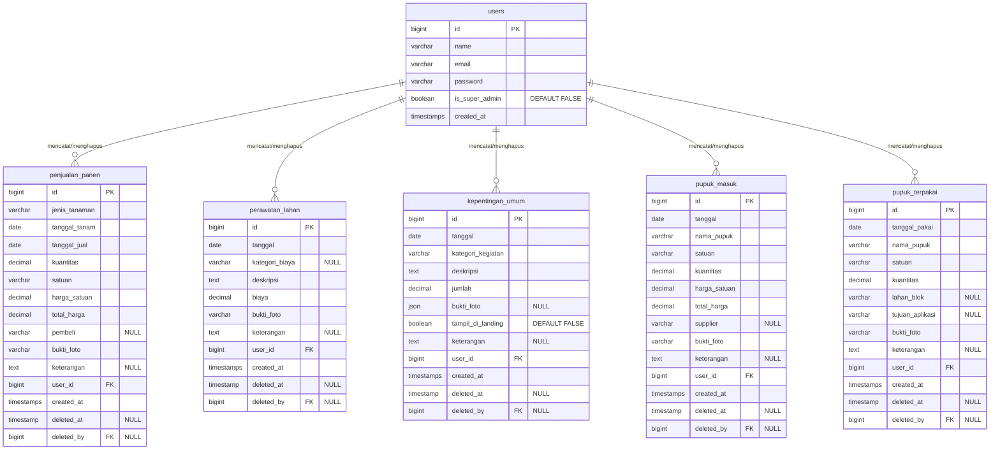

# Spesifikasi Lengkap & Final Database SITANI (Untuk Pembuatan ERD & Migration)

Dokumen ini berisi struktur lengkap database SITANI hasil finalisasi. Silakan gunakan panduan di bawah ini untuk membuat ERD dan menyusun file migration dari awal.

## 1. Entity Relationship Diagram (ERD)

Kamu bisa memvisualisasikan *code* di bawah ini menggunakan **Mermaid Live Editor** (https://mermaid.live) untuk melihat gambaran relasinya:

---

## 2. Struktur Detail Tabel

Semua tabel wajib memiliki `id` (Primary Key, auto increment/bigint) dan `timestamps` (created_at, updated_at).

### A. Tabel Core / Master
1. **`users`**
   - `name`, `email`, `password` (bawaan Laravel).
   - `is_super_admin` (boolean, default `false`).

**(Tabel `master_pupuk` dihapus karena data pupuk berupa kotoran hewan langsung diinput manual per transaksi tanpa perlu master/stok).**

### B. Tabel Transaksi
Semua tabel transaksi di bawah wajib memiliki:
- `user_id` (bigint unsigned, FK -> users) — *pembuat record*.
- `deleted_at` (timestamp, nullable) — *soft deletes*.
- `deleted_by` (bigint unsigned, FK -> users, nullable) — *pelaku penghapusan record*.

1. **`penjualan_panen`**
   - `jenis_tanaman` (varchar)
   - `tanggal_tanam` (date)
   - `tanggal_jual` (date)
   - `kuantitas` (decimal)
   - `satuan` (varchar)
   - `harga_satuan` (decimal)
   - `total_harga` (decimal)
   - `pembeli` (varchar, nullable)
   - `bukti_foto` (varchar) — *path gambar tunggal*
   - `keterangan` (text, nullable)

2. **`perawatan_lahan`**
   - `tanggal` (date)
   - `kategori_biaya` (varchar, nullable) — *teks bebas (bukan enum)*
   - `deskripsi` (text)
   - `biaya` (decimal)
   - `bukti_foto` (varchar) — *path gambar tunggal*
   - `keterangan` (text, nullable)

3. **`kepentingan_umum`**
   - `tanggal` (date)
   - `kategori_kegiatan` (varchar) — *teks bebas (bukan enum)*
   - `deskripsi` (text)
   - `jumlah` (decimal)
   - `bukti_foto` (json, nullable) — **PENTING: JSON Array untuk multiple foto**
   - `tampil_di_landing` (boolean, default `false`) — *flag untuk masuk ke halaman publik*
   - `keterangan` (text, nullable)

4. **`pupuk_masuk`**
   - `tanggal` (date)
   - `nama_pupuk` (varchar) — *input manual (misal: "Kotoran Sapi", "Kotoran Kambing")*
   - `satuan` (varchar) — *misal: "Karung", "Truk"*
   - `kuantitas` (decimal)
   - `harga_satuan` (decimal)
   - `total_harga` (decimal)
   - `supplier` (varchar, nullable) — *misal nama peternak sekitar*
   - `bukti_foto` (varchar) — *path gambar tunggal*
   - `keterangan` (text, nullable)

5. **`pupuk_terpakai`**
   - `tanggal_pakai` (date)
   - `nama_pupuk` (varchar) — *input manual*
   - `satuan` (varchar) — *input manual*
   - `kuantitas` (decimal)
   - `lahan_blok` (varchar, nullable) — *teks bebas (bukan enum/FK)*
   - `tujuan_aplikasi` (varchar, nullable)
   - `bukti_foto` (varchar) — *path gambar tunggal*
   - `keterangan` (text, nullable)

---

## 3. Business Rules (Catatan Penting Untuk Backend)

1. **Penghapusan Tabel Master Pupuk**
   Karena sifat pupuk yang diambil dari kotoran hewan peternak sekitar dan cenderung tidak membutuhkan *tracking* stok layaknya pupuk kimia komersial (stok gudang), maka **tabel `master_pupuk` dihapus dari skema**. Kolom relasi `pupuk_id` pada `pupuk_masuk` dan `pupuk_terpakai` diganti menjadi input teks manual (`nama_pupuk` dan `satuan`). Aplikasi cukup berfungsi sebagai *log* pencatatan histori pupuk masuk dan terpakai.

2. **Kolom Kategori & Lahan = Teks Bebas**
   Tidak ada pembuatan tabel `master_kategori` atau `master_lahan`. Kolom seperti `kategori_biaya`, `kategori_kegiatan`, dan `lahan_blok` cukup `varchar` biasa yang diisi manual.

3. **Perhitungan Total Harga**
   Kolom `total_harga` (di `penjualan_panen` & `pupuk_masuk`) **BUKAN** *generated column* di database. Gunakan kolom `decimal` biasa. Di level UI, nilainya dihitung reaktif (`kuantitas` * `harga_satuan`) namun tetap *editable* agar admin bisa menyesuaikan jika ada pembulatan kas/nego dengan peternak.

4. **Keamanan Data Halaman Publik (Landing Page)**
   - API / Controller untuk *Landing Page* Guest yang memanggil data `kepentingan_umum` (dimana `tampil_di_landing` = `true`) **TIDAK BOLEH** me-*load* kolom rahasia seperti `jumlah`, `user_id`, atau `keterangan` internal. Gunakan *Select* secara eksplisit: `select('tanggal', 'kategori_kegiatan', 'deskripsi', 'bukti_foto')`.
   - **Upload Foto & EXIF**: Semua foto bukti harus di-*strip*/dihapus metadata EXIF-nya (termasuk tag koordinat GPS) sebelum di-save ke disk untuk menjaga privasi lokasi.

5. **Format Data `kepentingan_umum`**
   Di model Eloquent, pastikan `bukti_foto` di-cast ke `array` dan `tampil_di_landing` di-cast ke `boolean`.